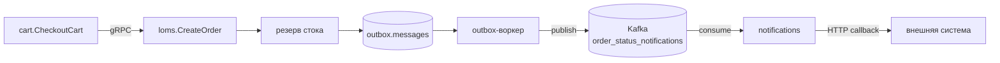
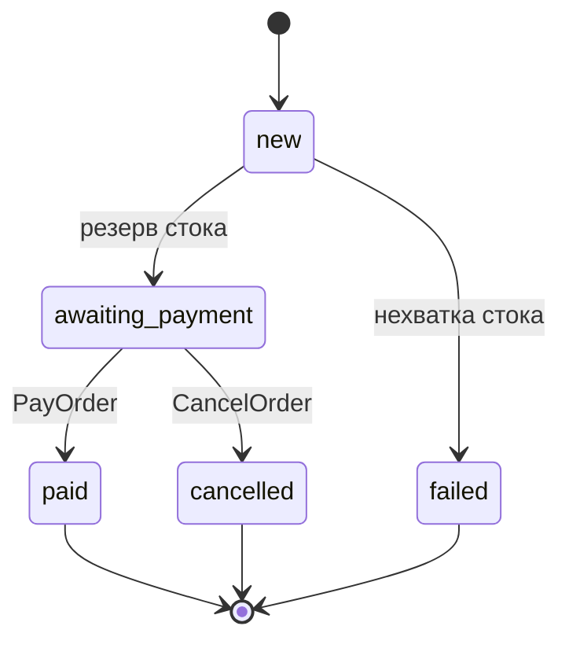
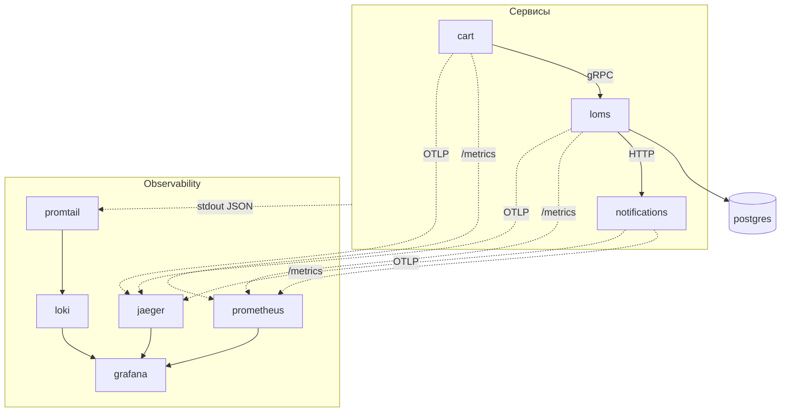
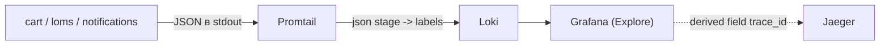
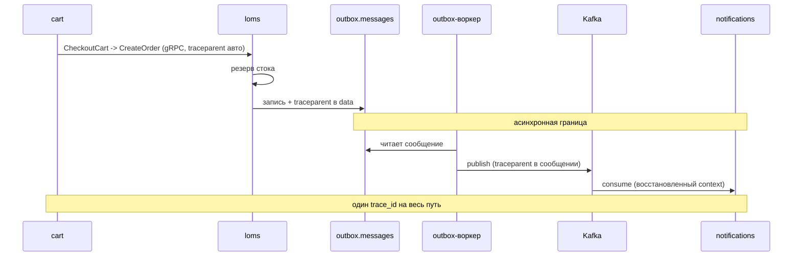
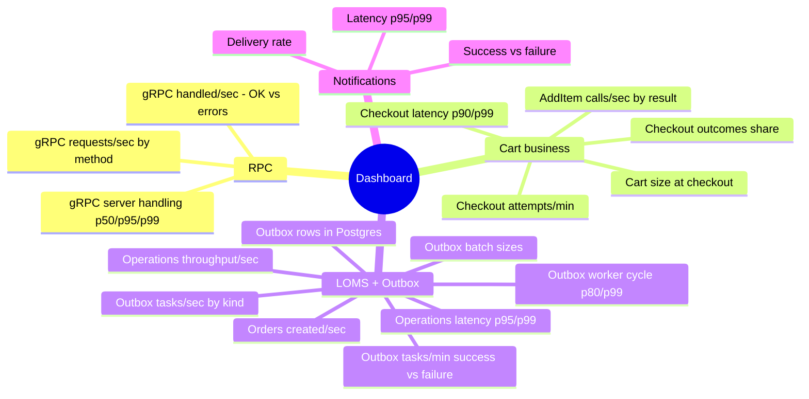

# HW 3 (Observability) - E-Commerce

<p align="center">
  
</p>


В этом домашнем задании вам предстоит добавить observability в ваш сервис **e-commerce**
(`cart`, `loms`, `notifications`). Задание построено по аналогии с занятием по observability,
но адаптировано под **распределённую** архитектуру из нескольких сервисов.

Ветка с решением должна называться `observability`. Важно, чтобы в PR не было diff'a из старых заданий
(`database`, `outbox`). Вы можете добиться этого, сделав `rebase` на `main` после проверки предыдущих ДЗ.

> Ниже описана одна из возможных конфигураций. Вы можете использовать **любой другой observability-стек**
> (например, OpenTelemetry Collector + Tempo + Mimir вместо Jaeger + Prometheus), главное - выполнить
> требования задания и пояснить выбор в отчёте.

Задание может быть оценено на частичный балл, если выполнены не все пункты.

---

## Предыдущие задания

Чтобы понимать, что и зачем мы инструментируем, необходимо вспомнить доменную модель из предыдущих ДЗ:

| Сервис          | Назначение                              | Хранилище                                                                    |
|-----------------|-----------------------------------------|------------------------------------------------------------------------------|
| `cart`          | Корзина пользователя, чекаут            | `cart.items`                                                                  |
| `loms`          | Заказы, склад, товары + `outbox`        | `loms.orders`, `loms.order_info`, `loms.products`, `loms.available_stocks`, `loms.reserved_stocks`, `outbox.messages` |
| `notifications` | Consumer Kafka -> доставка callback во внешнюю систему     | -                                                                            |

Основной бизнес-флоу (доставка уведомлений переведена на Kafka в предыдущем ДЗ):



`loms` не вызывает `notifications` напрямую: outbox-воркер публикует событие смены статуса в Kafka-топик
`order_status_notifications`, а `notifications` читает его как consumer и доставляет callback во внешнюю
систему (гарантия `at least once`).

Статусы заказа (`loms.order_status`):



Ключевые gRPC-эндпоинты:

* `cart`: `AddItem`, `DeleteItem`, `ListCart` (stream), `ClearCart`, `CheckoutCart`
* `loms`: `CreateOrder`, `GetOrder`, `PayOrder`, `CancelOrder`, `Stocks/GetStock`, `Stocks/SetStock`, `ProductService/CreateProduct`, `ProductService/GetProduct`
* `notifications`: читает события из Kafka-топика `order_status_notifications` и доставляет callback во внешнюю систему (gRPC-метод `SendOrderStatusChangedNotification` сохранён с прошлых ДЗ)

---

## Запуск в Docker

Все сервисы (`cart`, `loms`, `notifications`) уже умеют запускаться в `Docker`: их `Dockerfile`'ы и
базовый `docker-compose` (сервисы + `postgres` + `kafka` + интеграционные тесты) предоставляются тестовым
окружением — писать их с нуля не нужно. Ваша задача в этой части — поднять весь стек и **дополнить**
`docker-compose.yml` observability-инфраструктурой, подключив к ней сервисы.

Предоставляемый `Dockerfile` устроен примерно так (приведён для справки; при необходимости можно
адаптировать под свой `Taskfile`/`Makefile` и multi-module `go.work`):

```dockerfile
FROM golang:latest

WORKDIR /application
COPY . .
RUN task generate && (GOOS=linux GOARCH=amd64 task build:loms)
CMD ["./bin/loms"]
```

В `docker-compose.yml` должны подниматься как минимум:

* `postgres` (с healthcheck)
* `kafka` (брокер для доставки уведомлений о статусах заказа)
* ваши сервисы `cart`, `loms`, `notifications`
* `prometheus`, `grafana` (или их аналоги)
* `loki`, `promtail` (или их аналоги) 
* `jaeger` (или его аналог)

Рекомендуемая схема выглядит следующим образом:



```yaml
loms:
  build:
    context: .
    dockerfile: loms/Dockerfile
  depends_on:
    postgres:
      condition: service_healthy
    jaeger:
      condition: service_started
  environment:
    ...
  ports:
    ...
  networks:
    - internal
```

> **Важно:** каждый сервис должен корректно обрабатывать `SIGINT`/`SIGTERM` (graceful shutdown),
> иначе тесты и `docker compose down` будут работать некорректно.

**В данном задании разрешается хардкодить адреса в конфигах observability-инфраструктуры.**

> В текущей облегченной версии задания тестов нет, вам нужно лишь показать финальный видеоотчет

---

## Логи (Loki + Promtail + Grafana)

Поддержите экспорт и отображение логов всех сервисов.

* Хранение и обработка логов - [Loki](https://grafana.com/docs/loki/latest/)
* Экспорт логов - [Promtail](https://lyz-code.github.io/blue-book/promtail/) (или sidecar/драйвер на ваш выбор)
* Отображение - [Grafana](https://grafana.com/docs/grafana/latest/dashboards/)

Логирование - через [`zap`](https://github.com/uber-go/zap) (он уже используется в проекте).
Пишите логи в **JSON**, чтобы Promtail мог распарсить поля в метки.



### Требования

* Должна быть возможность **быстро** искать логи по меткам (labels).
* Должно быть поддержано **не менее 5 меток**.
* При проверке оценивается **поисковая полезность и кардинальность** тегов - обязательно дайте
  пояснения в отчёте.

### Рекомендованные метки и обоснование кардинальности

Рекомендуемый набор:

| Метка        | Кардинальность | Зачем                                                                 |
|--------------|----------------|-----------------------------------------------------------------------|
| `service`    | низкая (3)     | Разделять логи `cart` / `loms` / `notifications`                        |
| `level`      | низкая (~4)    | Быстро находить `error`/`warn`                                          |
| `grpc_method`| низкая (~15)   | Логи конкретного эндпоинта                                              |
| `kind`       | низкая (~2)    | Тип outbox-сообщения                                                    |
| `status`     | низкая (5)     | Статус заказа (`new`/`paid`/...) - фильтровать проблемные переходы      |

А вот эти поля кладите в **тело лога (JSON-поля), но НЕ в метки** - у них высокая кардинальность и они
взорвут индекс Loki:

* `trace_id` - связь лог <-> трейс; для перехода используйте **derived field** в Grafana, а не метку
* `order_id`, `user_id`, `sku`, `idempotency_key` - высокая кардинальность, ищем через LogQL-фильтр
  (`| json | order_id="..."`), а не через метку.

> В отчёте объясните, почему именно эти поля стали метками, а не другие. Правило: метка = низкая
> кардинальность + по ней реально фильтруют дашборды; всё остальное - в JSON-тело.

Пример пайплайна Promtail (фрагмент):

```yaml
pipeline_stages:
  - json:
      expressions:
        level: level
        service: service
        grpc_method: grpc_method
        kind: kind
        status: status
        trace_id: trace_id   # извлекаем как поле, в labels не выносим
  - labels:
      level:
      service:
      grpc_method:
      kind:
      status:
```

---

## Трейсинг (Jaeger)

Настройте распределённый трейсинг через [Jaeger](https://www.jaegertracing.io/) и OpenTelemetry.

Используйте **готовый gRPC-интерцептор** `otelgrpc`:

```go
import "go.opentelemetry.io/contrib/instrumentation/google.golang.org/grpc/otelgrpc"

s := grpc.NewServer(
    grpc.UnaryInterceptor(
        otelgrpc.UnaryServerInterceptor(
            otelgrpc.WithTracerProvider(otel.GetTracerProvider()),
        ),
    ),
    grpc.StreamInterceptor(
        otelgrpc.StreamServerInterceptor(
            otelgrpc.WithTracerProvider(otel.GetTracerProvider()),
        ),
    ),
)
```

Интерцептор сам создаст span и пробросит `trace` из входящего запроса (или создаст новый).

```go
span := trace.SpanFromContext(ctx)
defer span.End()
```

### Особенность распределённой системы

Главная ценность трейсинга здесь - **сквозной трейс через несколько сервисов**. Один trace должен
связывать:



* На gRPC-вызове `cart -> loms` трейс пробрасывается **автоматически**, если у gRPC-клиента в `cart`
  подключён `otelgrpc.UnaryClientInterceptor`. Не забудьте проинструментировать клиентов, а не только серверы.
* Для передачи трейса через **outbox -> Kafka** (асинхронная граница) нужно сохранить `traceparent` в
  `outbox.messages.data` при записи, пробросить его в Kafka-сообщение при публикации (например, в
  заголовках) и восстановить контекст (`otel propagation`) в Kafka-consumer'е `notifications`.
  Покажите это в видео - это самая интересная часть.

> Писать собственный HTTP-middleware для gRPC-gateway **не нужно**.

### Требования

* В span'ах должны быть **теги для поиска соответствующих логов** (как минимум `trace_id`,
  а также бизнес-атрибуты: `order_id`, `user_id`).
* Оценивается поисковая полезность и кардинальность тегов - поясните в отчёте.

---

## Метрики (Prometheus + Grafana)

Реализуйте сбор метрик во **всех** сервисах. Поднимите для метрик **отдельный** HTTP-сервер
(отдельно от gRPC/gateway - чтобы разделять трафик и можно было вынести на другой интерфейс):

```go
func runMetricsServer(port string) {
    mux := http.NewServeMux()
    mux.Handle("/metrics", promhttp.Handler())
    _ = http.ListenAndServe(":"+port, mux)
}
```

По адресу `http://localhost:${METRICS_PORT}/metrics` должны отдаваться сырые метрики (включая
дефолтные `go_*`, `process_*` от `promhttp.Handler()` и ваши кастомные).

Конфиг Prometheus (scrape всех сервисов):

```yaml
global:
  scrape_interval: 10s

scrape_configs:
  - job_name: 'cart'
    static_configs: [{ targets: ['cart:9001'] }]
  - job_name: 'loms'
    static_configs: [{ targets: ['loms:9002'] }]
  - job_name: 'notifications'
    static_configs: [{ targets: ['notifications:9003'] }]
```

Подключите Prometheus и Loki как datasource в Grafana:

```yaml
apiVersion: 1
datasources:
  - name: Prometheus
    type: prometheus
    access: proxy
    url: http://prometheus:9090
    isDefault: true
  - name: Loki
    type: loki
    access: proxy
    url: http://loki:3100
    jsonData:
      maxLines: 1000
```

Постройте в Grafana **дешборд** со следующими разделами.

### Outbox (сервис `loms`)

В вашем `outbox` есть `kind` (`KindNotifications`, и задел на будущие). **Во всех графиках раздела
должна быть возможность смотреть состояние по каждому `kind`** (через label `kind` или template-переменную).

* График **количества задач** (по статусам `CREATED` / `IN_PROGRESS` / `SUCCESS`) - панель
  **«Outbox rows in Postgres»** (берётся отдельной горутиной запросом к БД, разбивка по `status`).
* График **скорости обработки** задач (обработано сообщений в секунду) - панель
  **«Outbox tasks / sec by kind»** (разбивка по `kind`).
* График **rate неуспешных** задач (ретраи / `MarkMessageAsRetryable`) - панель
  **«Outbox tasks / min (success vs failure)»** (две стрелочные/`stat`-панели: `success/min` и `failure/min`).
* График **длительности цикла воркера** (квантили p80 / p99) - панель
  **«Outbox worker cycle duration (p80 / p99)»** (сколько занимает одна итерация выгрузки батча).
* График **размера батча** воркера - панель **«Outbox batch sizes (recent buckets)»**
  (распределение количества сообщений, забранных за одну итерацию).

Подсказка по инструментированию:
* счётчик `outbox_messages_processed_total{kind, result}` в воркере (`result="success|failure"`);
* gauge `outbox_messages_in_status{kind, status}` (наполняется отдельной горутиной запросом к БД);
* histogram `outbox_worker_cycle_seconds{kind}` - длительность одной итерации воркера -> `histogram_quantile`;
* histogram `outbox_batch_size{kind}` - количество сообщений в забранном батче.

### gRPC handlers (все сервисы)

* График **количества горутин** `go_goroutines` (по сервисам).
* График **live heap** `go_memstats_heap_inuse_bytes` (по сервисам).
* График **RPS** - с возможностью посмотреть по **конкретному эндпоинту** (`grpc_method`) и сервису.
  Удобно показать топ нагруженных методов панелью **«gRPC requests / sec (by method)»** (bar gauge).
* График **latency** (квантили p50/p95/p99) - с возможностью посмотреть по **конкретному эндпоинту**;
  панель **«gRPC server handling p50 / p95 / p99»**.
* График **OK vs errors** - панель **«gRPC handled / sec - OK vs errors»**: rate успешных
  (`grpc_code="OK"`) против ошибочных вызовов (`grpc_code!="OK"`), по сервисам.

Подсказка: используйте
[`go.opentelemetry.io/contrib/.../otelgrpc`](https://github.com/grpc-ecosystem/go-grpc-middleware) или
свой interceptor, собирающий `grpc_server_handled_total{grpc_method, grpc_code}` и
`grpc_server_handling_seconds_bucket{grpc_method}` (histogram -> `histogram_quantile`).

### Postgres

(Часть метрик удобно собирать отдельными горутинами при старте сервиса, периодически опрашивая БД.)

* График **количества записей** по каждой таблице (`orders`, `order_info`, `products`,
  `available_stocks`, `reserved_stocks`, `outbox.messages`, `cart.items`).
* График **rate вставки** записей по каждой таблице.
* (*) Можно построить latency основных операций с БД - это требует обёртки над драйвером `pgx`
  (например, через `otelpgx` или свой `QueryTracer`). В данном задании **можно не строить**.

### Бизнес-метрики E-Commerce  ⭐

Все метрики этого раздела вы **инструментируете руками** в usecase-слое. Минимальный набор:

* **Rate создания заказов** - `orders_created_total` (counter), график rate (панель **«Orders created / sec»**);
  разбивка по результату.
* **Throughput операций оплаты/отмены** - панель **«Operations throughput / sec»**: rate успешных
  `PayOrder` и `CancelOrder` (`pay ok` / `cancel ok`), на основе `order_operations_total{op="pay|cancel", result}`.
* **Latency операций оплаты/отмены** - histogram `order_operation_seconds{op="pay|cancel"}`;
  панель **«Operations latency p95 / p99 (pay, cancel)»** (`histogram_quantile`).
* **Распределение заказов по статусам** - `orders_by_status{status}` (gauge или counter переходов
  `order_status_transitions_total{from,to}`). Видно, сколько заказов `paid` / `cancelled` / `failed`.
* **Конверсия чекаута** - `cart_checkout_total{result="success|fail"}`; на дашборде -
  success rate чекаута (`success / total`). Конкретные панели:
  **«Checkout attempts / minute (all results)»** (`stat` - суммарный rate попыток чекаута) и
  **«Checkout outcomes (share of traffic)»** (`pie`/donut - доля `ok` vs `error`).
* **Latency чекаута** - histogram `cart_checkout_seconds{result}`; панель
  **«Checkout latency (histogram -> p90 / p99)»** с разбивкой `ok` / `error`
  (p90 ok, p90 error, p99 ok, p99 error).
* **Rate вызовов `AddItem`** - `cart_additem_total{result="ok|error"}`; панель
  **«AddItem calls / sec by result»**.
* **Размер корзины на чекауте** - histogram количества **distinct SKU**
  `cart_checkout_items{}` (без разбивки по `sku`); панель-heatmap **«Cart size at checkout (distinct SKUs)»**.
* **Success rate оплат** - на основе `PayOrder` (`orders_paid_total` vs ошибки оплаты).
* **Rate отмен / фейлов заказов** - в частности из-за нехватки стока
  (`order_failed_total{reason="insufficient_stock"}`).
* **Резервирование склада** - `stock_reservation_total{result}` и/или gauge остатков
  `available_stock_units` (агрегированно, **без** разбивки по `sku`, чтобы не раздувать кардинальность;
  топ-N дефицитных SKU - отдельной таблицей/панелью при желании).
* **GMV / сумма заказов** - `order_amount_rubles` (histogram, `price * amount`); на дашборде -
  суммарная выручка за окно и средний чек.
* (*) **Средний размер заказа/корзины** - histogram количества позиций.

> В отчёте поясните, какие метрики counter, какие gauge, какие histogram, и **почему вы не выносили
> `sku`/`user_id`/`order_id` в labels** (кардинальность). 

### Эталонная структура дашборда

Дашборд разбит на свёрнутые разделы (rows). Ориентируйтесь на следующий набор панелей
(заголовки можно сохранить как есть):



**RPC (Prometheus histogram percentiles)**
* `gRPC server handling p50 / p95 / p99` - latency хендлеров (timeseries).
* `gRPC requests / sec (by method, top workload)` - RPS по методам (bar gauge).
* `gRPC handled / sec - OK vs errors` - успешные vs ошибочные вызовы (timeseries).

**Cart business metrics**
* `Checkout attempts / minute (all results)` - суммарный rate попыток чекаута (stat).
* `Checkout outcomes (share of traffic)` - доля `ok` / `error` (pie/donut).
* `Checkout latency (histogram -> p90 / p99)` - latency чекаута, разбивка `ok` / `error` (timeseries).
* `Cart size at checkout (distinct SKUs)` - распределение размера корзины (heatmap).
* `AddItem calls / sec by result` - rate `AddItem` по результату (timeseries).

**LOMS + Outbox**
* `Orders created / sec` - rate создания заказов (timeseries).
* `Operations throughput / sec` - `pay ok` / `cancel ok` (timeseries).
* `Operations latency p95 / p99 (pay, cancel)` - latency оплаты/отмены (timeseries).
* `Outbox rows in Postgres` - количество строк по статусам (timeseries).
* `Outbox tasks / min (success vs failure)` - две gauge-панели `success/min` и `failure/min`.
* `Outbox worker cycle duration (p80 / p99)` - длительность итерации воркера (timeseries).
* `Outbox batch sizes (recent buckets)` - размеры батчей (table/heatmap).
* `Outbox tasks / sec by kind` - обработка задач по `kind` (timeseries).

**Notifications**
* Rate доставки уведомлений и success/failure доставки.
* Latency доставки (p95 / p99) - `SendOrderStatusChangedNotification`.

> Точный набор и оформление панелей - на ваше усмотрение, но **все разделы и метрики из пунктов
> 4.1–4.4 должны присутствовать** и быть разбиты по понятным rows, как выше.

### Особенности

* Дешборд должен быть **красивым** и читаемым (понятные заголовки, единицы измерения, легенды).
* Используйте **template-переменные** Grafana (`$service`, `$grpc_method`, `$kind`) вместо
  дублирования панелей.
* Сохраните дешборд как JSON в репозиторий (provisioning), чтобы он поднимался автоматически.

---

## Видеоотчёт (до 6 минут)

Запишите видеоотчёт **до 6 минут**, в котором продемонстрируете выполненное задание и дадите комментарии:

1. Запуск всего стека через `docker compose up`.
2. Логи в Grafana/Loki: поиск по меткам, переход лог -> трейс.
3. Сквозной трейс `cart -> loms -> notifications` в Jaeger (включая проброс через outbox и Kafka).
4. Дешборд метрик под нагрузкой: outbox, handlers, postgres и **бизнес-метрики**.

Для генерации нагрузки напишите кастомные сценарии, рекомендуется [k6](https://k6.io/).
Сценарий должен затрагивать **весь бизнес-флоу** (положить в корзину -> чекаут -> оплата/отмена),
чтобы ожили бизнес-метрики:

```javascript
import http from 'k6/http';
import { check, sleep } from 'k6';

export const options = { vus: 10, duration: '60s' };

export default function () {
    const userId = (__VU % 5) + 1;
    const sku = [1001, 1002, 1003][__ITER % 3];

    // 1. add to cart
    http.post(`http://localhost:8081/v1/cart/${userId}/items`,
        JSON.stringify({ sku, amount: 1 }), { headers: { 'Content-Type': 'application/json' } });

    // 2. checkout -> создаёт заказ в loms
    const res = http.post(`http://localhost:8081/v1/cart/${userId}/checkout`, null);
    check(res, { 'checkout ok': (r) => r.status === 200 });

    sleep(1);
}
```

> **Не пушьте видео в GitHub** - загрузите на сторонний ресурс и приложите ссылку в комментарии к PR. Рекомендуется использовать Yandex Disk.

---

## Рекомендуемые технологии

* Структура - [go-clean-template](https://github.com/evrone/go-clean-template) +
  [шаблон лекций](https://github.com/itmo-org/lectures/tree/main/sem2/lecture1)
* Логирование - [`zap`](https://github.com/uber-go/zap)
* Трейсинг - OpenTelemetry + `otelgrpc` + [Jaeger](https://www.jaegertracing.io/)
* Метрики - [Prometheus](https://prometheus.io/) + [Grafana](https://grafana.com/)
* Логи - [Loki](https://grafana.com/docs/loki/latest/) + [Promtail](https://lyz-code.github.io/blue-book/promtail/)
* Нагрузка - [k6](https://k6.io/)

---

## Локальный запуск

- `task update hw=hw3` — скачивает docker-compose файлы для тестирования и локального запуска
- `task frontend` — запускает frontend, перед выполнением необходимо установить [npm](https://docs.npmjs.com/downloading-and-installing-node-js-and-npm)
- `task backend` — запускает backend
- На Windows без WSL многое может не работать


## Скрипты

Для запуска скриптов на курсе необходимо установить [go-task](https://taskfile.dev/docs/installation)

`go install github.com/go-task/task/v3/cmd/task@latest`

Перед выполнением задания не забудьте выполнить:

```bash
task update hw=hw3
```

При возникновении ошибок с `task update` ознакомьтесь с [гайдом](https://github.com/igoroutine-courses/guide.github_scripts)

Запустить линтер:
```bash
task lint
```

Запустить тесты:
```bash
task test
```

Обновить файлы задания:
```bash
task update hw=hw3
```

Принудительно обновить файлы задания:
```bash
task force-update hw=hw3
```

Запустить генерацию кода:
```bash
task generate
```

Запустить backend в docker:
```bash
task backend
```

Запустить frontend в docker:
```bash
task frontend
```

Скрипты работают на Windows, однако при разработке на этой операционной системе рекомендуется использовать [WSL](https://learn.microsoft.com/en-us/windows/wsl/install)
